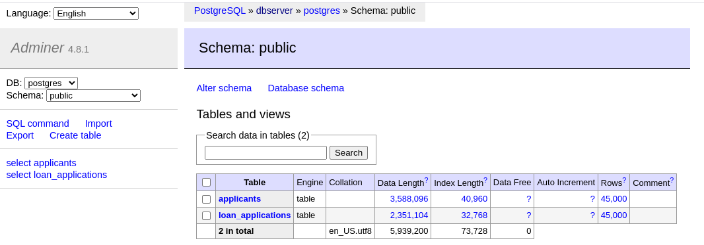

## Docker and databases hands-on exam

Your goal is to solve the following tasks:

### 1. Setup the Docker compose stack
Implement the following services in a docker-compose.yml:
- [postgres](https://hub.docker.com/_/postgres/)
    - Image: `postgres:17.2`
    - Service name: `dbserver`
    - Set the default password to `ulfrids` (the default username is `postgres`)
    - Find a way to initialize the database with the `dump.sql` file provided in the `data` folder of this repository.
    - Map the default postgres container port to port `5432` on the host.
    - Use an appropriate mechanism of persisting the data in the database after the container has been removed - map Postgres' data folder in the container to ./pgdata on the host (if possible, otherwise explain why you cannot map it and use a regular Docker volume).
- [adminer](https://hub.docker.com/_/adminer)
    - Image: `adminer:latest`
    - Service name: `dbgui`
    - Map adminer's web interface default container port to port `6836` on the host. The Adminer web interface should now be accessible at [http://localhost:6836](http://localhost:6836)

After your docker compose stack is up and running take a screenshot of it's web interface, with entered login credentials and database url.

### TODO: screenshot of used credentials to log in
<!--  -->

The database should now have your data.

### 2. SQL
Implement the `task.ipynb` notebook.

### 3. Predictive modeling

### 4. Make your work reproducible
- requirements.txt
- seeding randomness
- commands for running the docker stack
TODO...