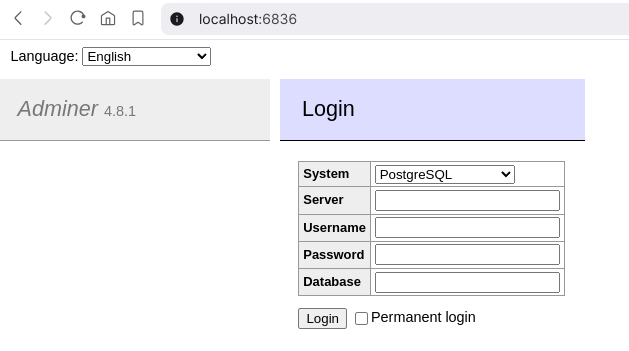
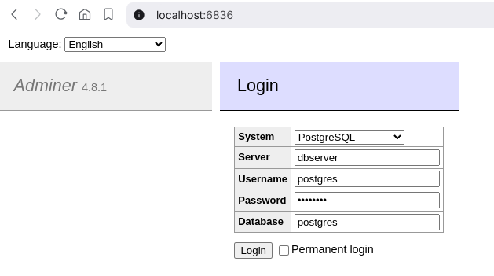

## Docker and databases hands-on exam

Your goal is to solve the following tasks:

### PART 1: Setup the Docker compose stack
Implement the following services in a docker-compose.yml:
- [postgres](https://hub.docker.com/_/postgres/)
    - Image: `postgres:17.2`
    - Service name: `dbserver`
    - Set the default password to `ulfrids` (the default username is `postgres`)
    - Find a way to initialize the database with the `dump.sql` file provided in the `init` folder of this repository when the database container starts.
    - Map the default postgres container port to port `5432` on the host.
    - Use an appropriate mechanism of persisting the data in the database after the container has been removed - map Postgres' data folder in the container to ./pgdata on the host (if possible, otherwise explain why you cannot map it and use a regular Docker volume).
- [adminer](https://hub.docker.com/_/adminer)
    - Image: `adminer:latest`
    - Service name: `dbgui`
    - Map adminer's web interface default container port to port `6836` on the host. The Adminer web interface should now be accessible at [http://localhost:6836](http://localhost:6836)

After your docker compose stack is up and running take a screenshot of it's web interface, with entered login credentials and database url.

<!--  -->
#### TODO: add here a screenshot of used credentials to log in using Adminer UI.


The database should now have your data.

#### TODO: add here a screenshot of Adminer UI where tables of the provided database can be visible.


#### TODO: add here command(s) for running the docker compose stack in a detached mode:
```bash
docker compose up -d
```

#### The expected results of this phase are:
- a `docker-compose.yml` file in the root of this repository implementing the stack above.
- a screenshot of the adminer web interface with filled in fields to connect to the database
- a screenshot of the adminer web interface when logged-in, showing the two tables (`loan_applications` and `applicants`)
- the command(s) needed to run the docker compose stack

### PART 2: SQL
Follow the instructions in `sql.ipynb` to implement the solutions. 

Provide the commands to setup the python environment for running the notebook (requirements.txt or environment.yml)
```bash
TODO: write commands here
conda env create -f environment.yml
```

#### The expected results of this phase are:
- implemented everything required in `sql.ipynb`
- `requirements.txt` or `environment.yml` specifying the python environment (libraries) needed for running the notebook.
- saved `applicants_loan_applications.csv` in `predictive/data` folder

### PART 3: Predictive modeling
Your goal is to predict if a bank should approve a loan application or not.

Perform binary classification on the dataset `predictive/data/applicants_loan_applications.csv` you saved in the `sql.ipynb` notebook. The feature columns and target column are already specified in `predictive/model.py`.

Start by establishing a predictive baseline: a dummy classifier that always predicts the majority class. Evaluate the dummy classifier with [sklearn.metrics.classification_report](https://scikit-learn.org/stable/modules/generated/sklearn.metrics.classification_report.html) provided by scikit. Analogously, train a RandomForestClassifier and compare it to the baseline with the same `classification_report()`.

Here's an example output of the classification report for both models:


Now implement `predictive/Dockerfile` that specifes a custom container image (tag it `loanprediction`) based on `python:3.10-slim` that installs needed libraries and runs the `model.py` script from above on the provided data (use an appropriate docker mechanism to use the csv data file from the host).

#### TODO add here commands for buidling and running the custom docker container
```bash
cd predictive
docker build -t loanprediction .
docker run -v ./data:/model/data loanprediction
```

#### The expected results of this phase are:
- implemented `predictive/model.py` that:
    - reads the `predictive/data/applicants_loan_applications.csv` from the previous task
    - splits it into a train and test set with [sklearn.model_selection.train_test_split](https://scikit-learn.org/stable/modules/generated/sklearn.model_selection.train_test_split.html).
    - fits a dummy majority classifier as a predictive baseline ([sklearn.dummy.DummyClassifier](https://scikit-learn.org/stable/modules/generated/sklearn.dummy.DummyClassifier.html) and [sklearn dummy estimators user guide](https://scikit-learn.org/stable/modules/model_evaluation.html#dummy-estimators)).
    - fits a random forest classifier ([sklearn.ensemble.RandomForestClassifier](https://scikit-learn.org/stable/modules/generated/sklearn.ensemble.RandomForestClassifier.html))
    - compares performance of both with [sklearn.metrics.classification_report](https://scikit-learn.org/stable/modules/generated/sklearn.metrics.classification_report.html) on the test set (just print the classification_report() of each classifier).
- implemented `predictive/Dockerfile` that builds a standalone container image to run `model.py`. Tag the image as `loanprediction`
- written commands on how to build the container image from the `Dockerfile` and run it with the `applicants_loan_applications.csv` as the dataset.

### 4. Double-check your work & submit
Go through the instructions again and make sure you implemented everything as requested. Save all the files, include them into git (double check if everything needed is included) and push your work to the remote repository.
